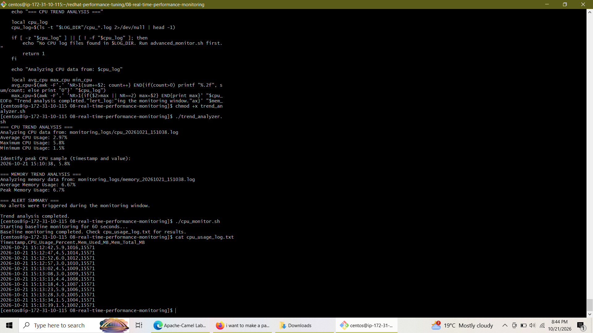

# Lab 8: Real-Time Performance Monitoring with `gnome-system-monitor`

<p align="left">
  
  
  
  
</p>

---

## **Overview**
This lab focuses on tracking and evaluating real-time system performance using both graphical monitoring tools (`gnome-system-monitor`) and powerful terminal-based stress-testing and auditing utilities (`stress-ng`, `top`, `ps`, `free`). The exercises cover baseline logging, synthetic CPU and memory load injection, Python-based memory leak simulation, process priority management (`renice`), and advanced trend analysis automation.

---

## **Objectives**
* Install and configure `gnome-system-monitor` for comprehensive graphical system auditing.
* Monitor CPU utilization patterns and identify bottlenecks using command-line scripts and tools.
* Analyze memory usage and detect resource consumption or leak behaviors.
* Track active processes, manage process execution priorities, and generate automated performance reports.
* Build advanced monitoring loops with threshold alerting and historical trend analysis.

---

## **Lab Tasks & Implementation**

### **Task 1: Baseline Monitoring & Package Preparation**
Installed essential performance suites (`stress-ng`, `sysstat`, `htop`, `bc`) and established a 60-second baseline logging script (`cpu_monitor.sh`) to capture unloaded resource metrics.

* **Deliverable Output (`cpu_usage_log.txt`):** Captures timestamped samples of CPU utilization percentages alongside memory allocation metrics on an idle system.

### **Task 2: Stress Testing & Memory Leak Simulation**
* **CPU Stress Testing:** Injected multi-core stress workloads via `stress-ng` and parsed top consumers using `cpu_analysis.sh`.
* **Memory Stress Testing & Leak Simulation:** Evaluated physical memory boundaries under pressure and ran a controlled Python script (`memory_leak_sim.py`) to simulate progressive resident set size (RSS) growth.

### **Task 3: Process Priority Management & Advanced Trend Analysis**
* **Priority Management:** Tested process execution priority changes using `renice` on a CPU-intensive background job.
* **Master Reporting & Trend Analytics:** Generated comprehensive snapshot logs and executed `trend_analyzer.sh` to compute statistical averages, peak metrics, and trigger automated alert thresholds.

---

## **Visual Deliverables & Screenshots**

### **1. Baseline CPU & Memory Monitoring**
```bash
./cpu_monitor.sh
cat cpu_usage_log.txt
```


### **2. Stress-Testing Workloads (`stress-ng`)**
```bash
stress-ng --cpu 4 --timeout 30s --metrics-brief
stress-ng --vm 1 --vm-bytes 512M --timeout 30s --metrics-brief
```


### **3. Memory Leak Simulation & RSS Sampling**
```bash
python3 memory_leak_sim.py &
```


### **4. Trend Analyzer & Alert Summary Report**
```bash
./trend_analyzer.sh
```


---

## **Conclusion**
Lab 8 successfully combined graphical monitoring interfaces with scriptable CLI automation. By implementing automated baseline loggers, stress-testing utilities, and advanced trend analysis scripts, system administrators can effectively diagnose real-time resource bottlenecks, predict capacity limits, and maintain high system performance standards across Linux environments.