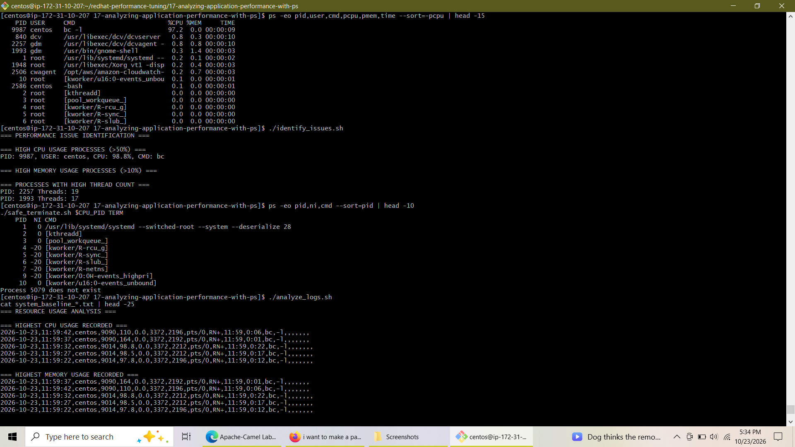
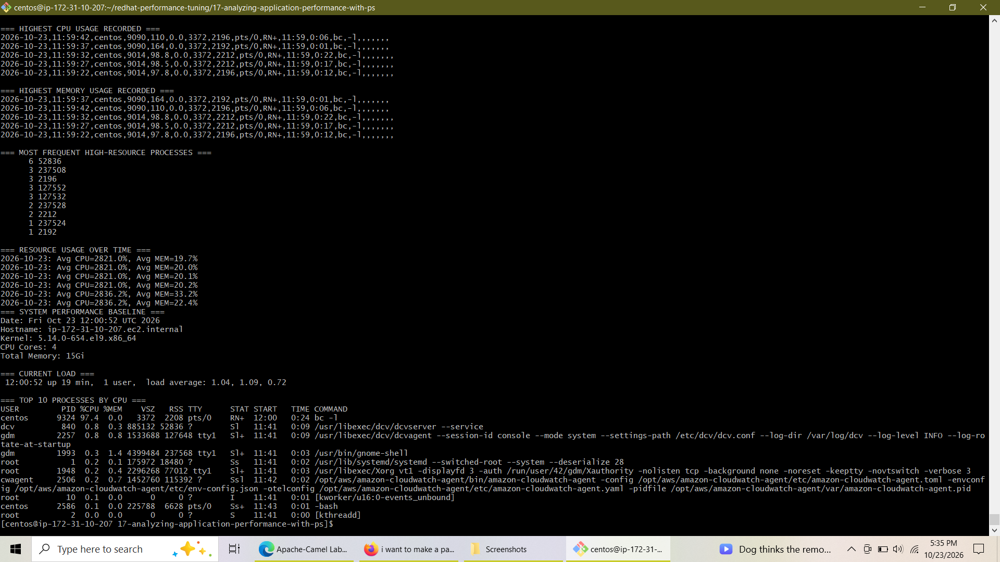

# Lab 17: Analyzing Application Performance with ps

---

## 📋 Overview
This lab demonstrates advanced techniques for process monitoring, performance diagnosis, resource management, and process control under Red Hat Enterprise Linux / CentOS. Using the native `ps` utility alongside custom Bash and Python automation scripts, this lab covers simulated workload generation, bottleneck detection, priority management using `nice`/`renice`, signal handling, continuous logging, and establishing system performance baselines.

---

## 🎯 Core Objectives & Capabilities
* **Process Inspection:** Master fundamental and advanced `ps` formatting syntax (`aux`, `auxf`, `-eo`, `--sort`).
* **Workload Simulation:** Engineer synthetic CPU-bound (`bc` mathematical loops) and memory-bound (Python bytearray allocation) workloads.
* **Bottleneck Identification:** Develop automated shell scripts to highlight processes exceeding high CPU (>50%) and memory (>10%) utilization thresholds.
* **Process Optimization:** Manage process scheduling priorities (`niceness`) and construct reliable, multi-signal termination utilities (`safe_terminate.sh`).
* **Resource Logging & Baselining:** Implement continuous resource logging utilities and compute statistical performance baselines across CPU cores and RAM.

---

## 🛠️ Step-by-Step Implementation Summary

### **Task 1: Custom Process Analysis & Synthetic Workload Deployment**
* Inspected active processes using hierarchical process trees (`ps auxf`) and user-filtered views (`ps ux`).
* Applied custom field extraction (`-eo pid,ppid,cmd,%mem,%cpu`) and sorted process trees by active CPU usage.
* Developed and deployed synthetic CPU-bound (`cpu_intensive.sh`) and memory-bound (`memory_intensive.py`) test processes into the background.

### **Task 2: Real-Time Process Monitoring & Bottleneck Identification**
* Established continuous live process inspection using `watch` loops tied to custom `ps` output filters.
* Created `process_monitor.sh` to generate instant system health reports including top CPU/RAM consumers, user process totals, zombie processes, and load averages.
* Built `identify_issues.sh` to scan runtime process metrics, automatically flagging high-utilization tasks and multi-threaded processes.

### **Task 3: Process Priority Optimization & Safe Signal Termination**
* Evaluated process scheduling niceness values (`NI` column) across active system processes.
* Demoted background workload priority using `renice 10 <PID>` and executed low-priority processes using `nice -n 15`.
* Built `safe_terminate.sh` to implement structured signal handling, attempting graceful termination (`SIGTERM` / `15`) prior to enforcing clean process removal (`SIGKILL` / `9`).
* Constructed `process_manager.sh`, an all-in-one command-line tool supporting process searching, user-based filtering, continuous monitoring, and automated report generation.

### **Task 4: Automated Resource Logging, Analysis & Baseline Generation**
* Executed `resource_tracker.sh` to record periodic process metrics into a structured CSV format (`process_resources.log`).
* Developed `analyze_logs.sh` to parse resource logs, computing peak CPU/memory consumers, high-frequency resource hogs, and average utilization metrics over time.
* Generated a full system baseline (`system_baseline_20261023.txt`) recording system kernel details, CPU count, total memory, uptime, and baseline process statistics.

---

## 📸 Verification & Screenshots

### **1. Advanced Process Formatting, Bottleneck Scan & Priority Management**
  
*Figure 1: Demonstration of custom `ps` column formatting sorted by CPU consumption, automated identification of high-CPU processes (`PID 9987` running `bc -l`), thread counts, nice value inspection, process termination handling, and initial execution of log analysis.*

### **2. Resource Log Metrics Analysis & System Performance Baseline**
  
*Figure 2: Execution output of `analyze_logs.sh` displaying most frequent high-resource process IDs and average CPU/Memory metrics over time, alongside the system baseline report capturing total RAM (15Gi), CPU core count (4 cores), load averages, and top background tasks.*

---

## 📌 Conclusion
Lab 17 demonstrates practical system administration and performance engineering skills on Red Hat systems. By leveraging the `ps` command alongside custom Bash scripts, system performance bottlenecks can be rapidly identified, analyzed, and remediated. The scripts created in this lab provide reusable tools for system monitoring, resource logging, priority adjustments, and baseline profiling across enterprise Linux environments.