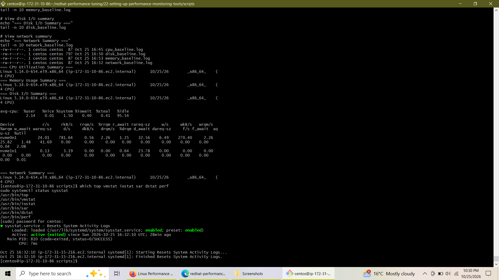
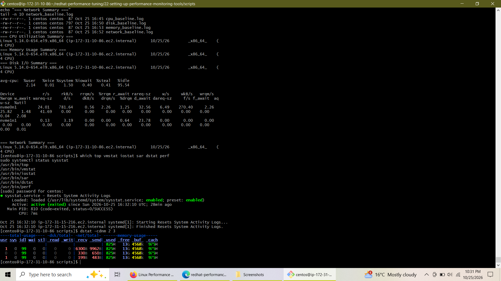
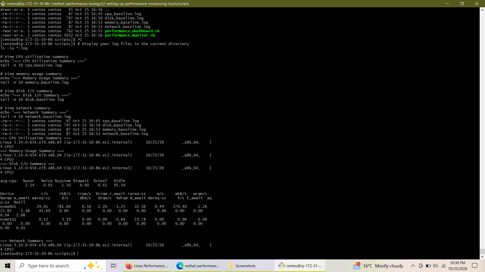

# Lab 2: Setting Up Performance Monitoring Tools


---

## 📌 Overview

This lab focuses on installing, configuring, and utilizing essential Linux performance monitoring utilities on Red Hat Enterprise Linux (RHEL). It covers manual diagnostic tools, service setup for automated historical data collection (`sysstat`), real-time metric gathering (`dstat`), and custom automation scripting for baseline profiling.

---

## 🎯 Objectives

- Install core performance analysis toolsets (`procps-ng`, `sysstat`, `dstat`, `perf`).
- Enable and verify continuous system activity logging via `sysstat.service`.
- Perform baseline resource profiling for CPU, memory, disk I/O, and network activity.
- Build automated Bash monitoring scripts and a live performance dashboard.
- Inspect and analyze performance log outputs.

---

## 🛠️ Tasks & Execution Steps

### Task 1: Package Installation & Service Setup

1. **Update package repositories:**
   ```bash
   sudo dnf update -y
   ```

2. **Install core monitoring packages:**
   ```bash
   sudo dnf install -y procps-ng sysstat dstat perf
   ```

3. **Enable and activate `sysstat` background collection:**
   ```bash
   sudo systemctl enable --now sysstat
   ```

4. **Verify binary paths and service status:**
   ```bash
   which top vmstat iostat sar dstat perf
   sudo systemctl status sysstat
   ```



---

### Task 2: Executing Real-Time Diagnostic Tools

Run multi-resource statistics tracking using `dstat` to monitor CPU, memory, disk, and network interfaces in real-time:

```bash
dstat -cdnm 2 3
```



---

### Task 3: Performance Automation & Log Analysis

#### 1. Real-Time Performance Dashboard Script (`scripts/performance_dashboard.sh`)
```bash
#!/bin/bash
while true; do
    clear
    echo "=========================================="
    echo "    SYSTEM PERFORMANCE DASHBOARD"
    echo "=========================================="
    echo "Timestamp: $(date)"
    echo ""
    echo "--- CPU Usage ---"
    top -bn1 | grep "Cpu(s)" | awk '{print $2 $3 $4 $5 $6 $7 $8}'
    echo ""
    echo "--- Memory Usage ---"
    free -h | grep -E "Mem|Swap"
    echo ""
    echo "--- Disk Usage ---"
    df -h | head -n 5
    echo ""
    echo "--- Load Average ---"
    uptime
    echo ""
    echo "Press Ctrl+C to exit..."
    sleep 5
done
EOF
```

#### 2. Analyzing Baseline Data Output
Review collected data logs (`cpu_baseline.log`, `disk_baseline.log`, `memory_baseline.log`, `network_baseline.log`):

```bash
# View log directory listing and data summaries
ls -la *.log

echo "=== CPU Utilization Summary ==="
tail -n 10 cpu_baseline.log

echo "=== Memory Usage Summary ==="
tail -n 10 memory_baseline.log

echo "=== Disk I/O Summary ==="
tail -n 10 disk_baseline.log

echo "=== Network Summary ==="
tail -n 10 network_baseline.log
```



---

## 🏁 Conclusion

In this lab, core Red Hat performance monitoring utilities were successfully installed, configured, and verified. Key achievements include:
- Establishing persistent metric collection with `sysstat`.
- Using `dstat` for multi-subsystem real-time profiling.
- Writing reusable shell scripts to automate monitoring and provide live dashboard capabilities.
- Successfully parsing baseline logs to verify system health and performance baselines.

This foundation prepares the environment for advanced bottleneck diagnosis and kernel performance tuning.