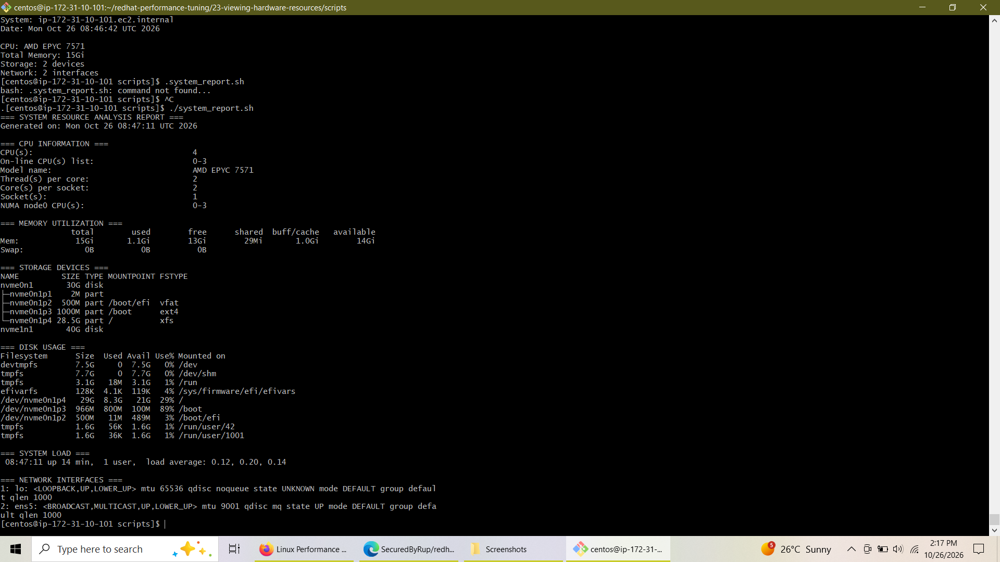
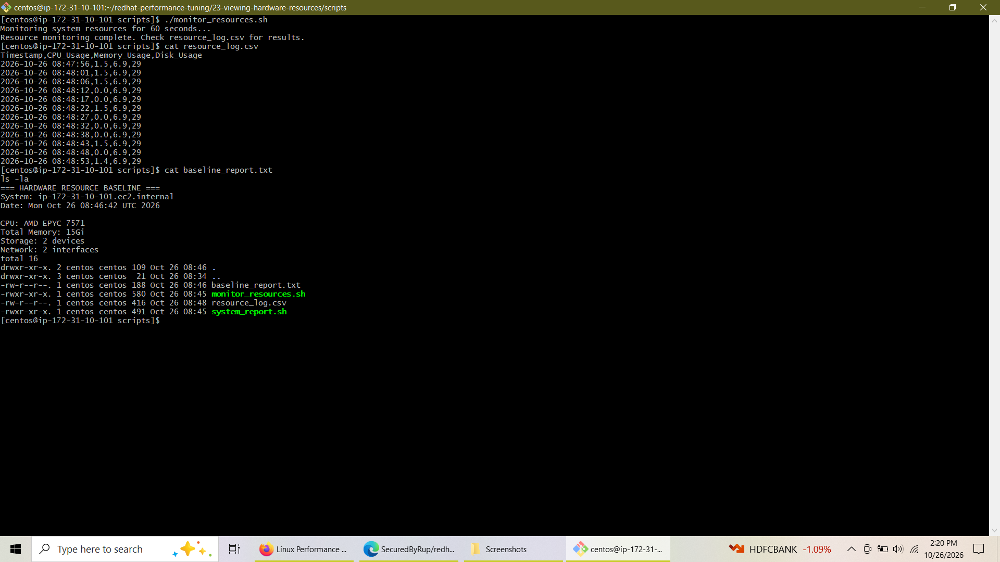

# Lab 3: Viewing Hardware Resources


## 📌 Overview

This lab provides hands-on experience in inspecting, diagnosing, and evaluating system hardware resources on Enterprise Linux environments. Key areas cover analyzing CPU architecture, examining memory and swap space allocation, mapping block storage devices and filesystems, inspecting physical and virtual hardware components, and building automated scripts for continuous resource monitoring and baseline generation.

## 🎯 Objectives

* **CPU Analysis:** Extract hardware specifications, cache hierarchies, core/thread topologies, and instruction set flags using `lscpu`.
* **Memory Diagnostics:** Evaluate active memory usage, buffer/cache allocations, and swap pressure via `free` and `/proc/meminfo`.
* **Storage Inspection:** Map block device topologies, filesystems, and partition structures using `lsblk` and `df`.
* **Hardware Profiling:** Inventory system architecture and network interface states using `lshw` and `ip`.
* **Automation & Monitoring:** Develop shell scripts (`system_report.sh` and `monitor_resources.sh`) to log live performance metrics to CSV format and compile baseline system reports.

---

## 🛠️ Tasks & Execution Steps

### Task 1: Analyzing CPU Resources with `lscpu`

1. Execute basic CPU architecture discovery:
   ```bash
   lscpu
   ```
2. Extract CPU operating frequencies, cache configurations, and instruction flags:
   ```bash
   lscpu | grep -E "(MHz|GHz)"
   lscpu | grep -i cache
   lscpu | grep Flags
   ```

---

### Task 2: Memory Analysis with `free` and `/proc/meminfo`

1. Display human-readable memory statistics and detailed buffer breakdowns:
   ```bash
   free -h --wide
   cat /proc/meminfo | head -20
   ```
2. Calculate exact memory utilization percentages and check swap state:
   ```bash
   free | awk 'NR==2{printf "Memory Usage: %.2f%%\n", $3*100/$2}'
   swapon --show
   ```

---

### Task 3: Storage Device Analysis with `lsblk` and `df`

1. Display block device layout, UUIDs, mount points, and filesystem types:
   ```bash
   lsblk -o NAME,SIZE,TYPE,MOUNTPOINT,FSTYPE,UUID
   ```
2. Inspect mounted disk space utilization:
   ```bash
   df -h
   ```

---

### Task 4: Hardware and Network Profiling with `lshw` and `ip`

1. Generate a concise hardware summary and inspect component classes:
   ```bash
   sudo lshw -short
   sudo lshw -class processor
   sudo lshw -class memory
   sudo lshw -class network
   ```
2. Verify active network interfaces and configurations:
   ```bash
   ip link show
   ip addr show
   ```

---

### Task 5: Automation Scripting and Baseline Analysis

#### 1. Comprehensive System Analysis Script (`scripts/system_report.sh`)

```bash
#!/bin/bash
echo "=== SYSTEM RESOURCE ANALYSIS REPORT ==="
echo "Generated on: $(date)"
echo ""

echo "=== CPU INFORMATION ==="
lscpu | grep -E "(Model name|CPU\(s\)|Thread|Core|Socket|MHz)"
echo ""

echo "=== MEMORY UTILIZATION ==="
free -h
echo ""

echo "=== STORAGE DEVICES ==="
lsblk -o NAME,SIZE,TYPE,MOUNTPOINT,FSTYPE
echo ""

echo "=== DISK USAGE ==="
df -h
echo ""

echo "=== SYSTEM LOAD ==="
uptime
echo ""

echo "=== NETWORK INTERFACES ==="
ip link show | grep -E "(^[0-9]|state)"
```



#### 2. Continuous Resource Monitoring Script (`scripts/monitor_resources.sh`)

```bash
#!/bin/bash
echo "Monitoring system resources for 60 seconds..."
echo "Timestamp,CPU_Usage,Memory_Usage,Disk_Usage" > resource_log.csv

for i in {1..12}; do
    timestamp=$(date '+%Y-%m-%d %H:%M:%S')
    cpu_usage=$(top -bn1 | grep "Cpu(s)" | awk '{print $2}' | cut -d'%' -f1)
    memory_usage=$(free | awk 'NR==2{printf "%.1f", $3*100/$2}')
    disk_usage=$(df / | awk 'NR==2{print $5}' | cut -d'%' -f1)
    
    echo "$timestamp,$cpu_usage,$memory_usage,$disk_usage" >> resource_log.csv
    sleep 5
done

echo "Resource monitoring complete. Check resource_log.csv for results."
```

#### 3. Baseline Summary Generation (`scripts/baseline_report.txt`)

```bash
echo "=== HARDWARE RESOURCE BASELINE ===" > baseline_report.txt
echo "System: $(hostname)" >> baseline_report.txt
echo "Date: $(date)" >> baseline_report.txt
echo "" >> baseline_report.txt
echo "CPU: $(lscpu | grep 'Model name' | cut -d':' -f2 | xargs)" >> baseline_report.txt
echo "Total Memory: $(free -h | awk 'NR==2{print $2}')" >> baseline_report.txt
echo "Storage: $(lsblk | grep disk | wc -l) devices" >> baseline_report.txt
echo "Network: $(ip link show | grep -c '^[0-9]') interfaces" >> baseline_report.txt
```



---

## 🏁 Conclusion

In this lab, comprehensive hardware discovery and resource utilization monitoring were successfully performed on Red Hat Enterprise Linux. 

Key accomplishments include:
1. **CPU & Memory Profiling:** Identified processor topology ($4\text{ CPUs}$, AMD EPYC 7571) and verified $15\text{ GiB}$ RAM availability with minimal swap activity.
2. **Storage Layout Mapping:** Mapped NVMe block devices (`nvme0n1` $30\text{G}$, `nvme1n1` $40\text{G}$) across partition mount points and XFS/ext4 filesystems.
3. **Automated Resource Monitoring:** Built custom Bash automation scripts to capture continuous resource trends to CSV format and auto-generate system baseline summaries.

These steps establish a clear hardware foundation for capacity planning, system optimization, and identifying potential performance bottlenecks.