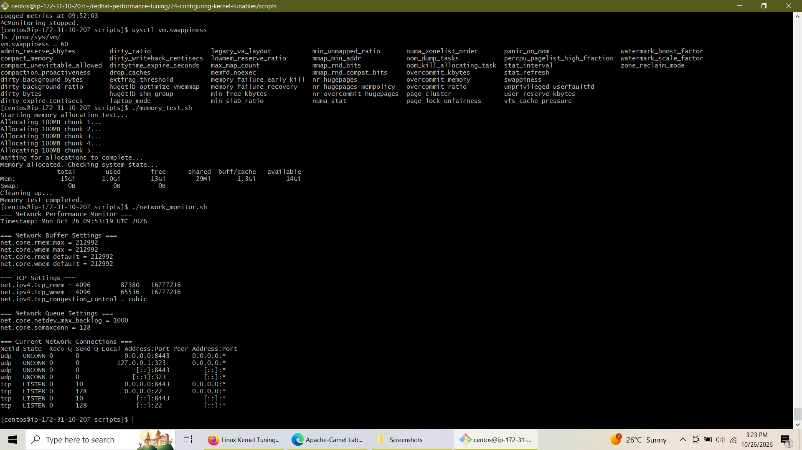
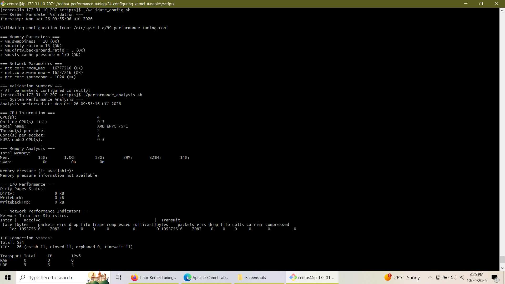
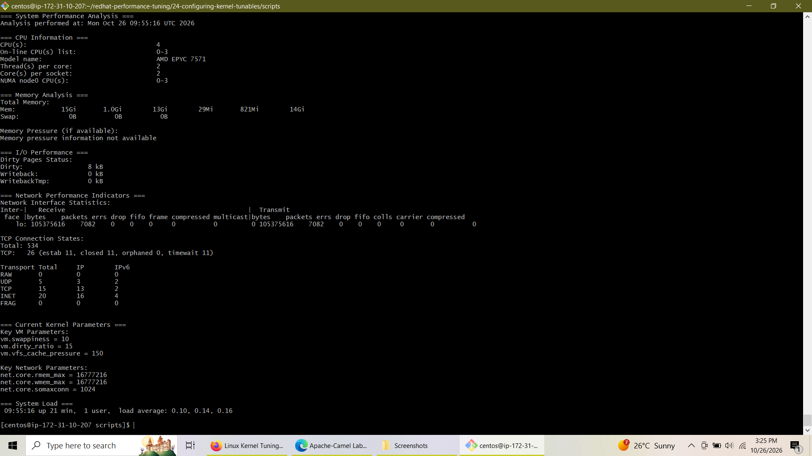

# Lab 4: Configuring Kernel Tunables


An end-to-end hands-on project focused on optimizing Linux kernel parameters for memory management, TCP/IP network throughput, and production system stability. This project covers runtime parameter inspection via `/proc/sys`, dynamic tuning using `sysctl`, persistent configuration setup via `/etc/sysctl.d/`, validation scripting, and safety rollback mechanisms.

---

## 📌 Table of Contents
- [Overview & Objectives](#-overview--objectives)
- [Architecture & Lab Environment](#-architecture--lab-environment)
- [Key Kernel Parameters Tuned](#-key-kernel-parameters-tuned)
- [Implementation Steps](#-implementation-steps)
  - [Task 1: Kernel Exploration & Baseline](#task-1-kernel-exploration--baseline)
  - [Task 2: Memory Parameter Optimization](#task-2-memory-parameter-optimization)
  - [Task 3: Network Parameter Optimization](#task-3-network-parameter-optimization)
  - [Task 4: Persistent Configuration & Validation](#task-4-persistent-configuration--validation)
  - [Task 5: Performance Analysis & Rollback Safety](#task-5-performance-analysis--rollback-safety)
- [Verification & Screenshots](#-verification--screenshots)
- [Conclusion](#-conclusion)

---

## 🎯 Overview & Objectives

Kernel tuning is a critical skill for Linux performance engineers and system administrators. Default operating system parameters are tailored for general-purpose workloads, which can lead to bottlenecks under high I/O or network-intensive enterprise workloads.

### Lab Objectives:
- **Explore Virtual Filesystem:** Navigate `/proc/sys` and interact with subsystem tunables.
- **Optimize Virtual Memory (VM):** Adjust swappiness, dirty page writeback ratios, and VFS cache pressure.
- **Enhance Network Throughput:** Expand TCP receive/send socket buffers and backlog queues.
- **Establish Persistence:** Ensure custom kernel configurations survive reboot using `/etc/sysctl.d/`.
- **Automation & Safety:** Write custom Bash scripts for baseline monitoring, configuration validation, continuous metric tracking, and safe rollbacks.

---

## 💻 Architecture & Lab Environment

- **OS Environment:** CentOS / RHEL 8 Enterprise Linux
- **Working Directory:** `/home/centos/redhat-performance-tuning/24-configuring-kernel-tunables/scripts`
- **Configuration File:** `/etc/sysctl.d/99-performance-tuning.conf`
- **Core Utilities:** `sysctl`, `free`, `ss`, `lscpu`, `dd`, `nc`

---

## ⚙️ Key Kernel Parameters Tuned

| Subsystem | Parameter | Default Value | Optimized Value | Description / Purpose |
| :--- | :--- | :--- | :--- | :--- |
| **VM** | `vm.swappiness` | `60` | `10` | Reduces swap tendency; keeps active processes in physical RAM. |
| **VM** | `vm.dirty_ratio` | `20` | `15` | Max % of memory for dirty pages before forcing synchronous disk flushes. |
| **VM** | `vm.dirty_background_ratio` | `10` | `5` | % of memory where background pdflush/flush threads begin writing to storage. |
| **VM** | `vm.dirty_writeback_centisecs` | `500` | `500` | Interval between background dirty page flush attempts (in hundredths of a second). |
| **VM** | `vm.vfs_cache_pressure` | `100` | `150` | Reclaims directory and inode caches more aggressively to free memory. |
| **Network** | `net.core.rmem_max` | `212992` | `16777216` | Maximum socket receive buffer size (16MB). |
| **Network** | `net.core.wmem_max` | `212992` | `16777216` | Maximum socket send buffer size (16MB). |
| **Network** | `net.core.rmem_default` | `212992` | `262144` | Default socket receive buffer size (256KB). |
| **Network** | `net.core.wmem_default` | `212992` | `262144` | Default socket send buffer size (256KB). |
| **Network** | `net.ipv4.tcp_rmem` | `4096 87380 ...` | `4096 87380 16777216` | Minimum, default, and maximum TCP receive buffer sizes. |
| **Network** | `net.ipv4.tcp_wmem` | `4096 65536 ...` | `4096 65536 16777216` | Minimum, default, and maximum TCP send buffer sizes. |
| **Network** | `net.core.netdev_max_backlog` | `1000` | `5000` | Maximum packets queued on input interface before processing. |
| **Network** | `net.core.somaxconn` | `128` | `1024` | Maximum socket listen queue length for bursty TCP connections. |

---

## 🚀 Implementation Steps

### Task 1: Kernel Exploration & Baseline
Examine `/proc/sys` and test basic `sysctl` parameter commands:
```bash
# Explore virtual filesystem categories
ls -la /proc/sys/
ls /proc/sys/vm/
ls /proc/sys/net/

# Query specific parameters
sysctl vm.swappiness
```

### Task 2: Memory Parameter Optimization
Constructed a local memory stress test script (`memory_test.sh`) to evaluate RAM allocation behavior under load:
```bash
chmod +x memory_test.sh
./memory_test.sh
```

### Task 3: Network Parameter Optimization
Created `network_monitor.sh` and `network_test.sh` to measure throughput and monitor buffer constraints:
```bash
chmod +x network_monitor.sh network_test.sh
./network_monitor.sh
./network_test.sh
```

### Task 4: Persistent Configuration & Validation
Persisted all kernel parameters into a custom drop-in file and reloaded system configuration:
```bash
sudo tee /etc/sysctl.d/99-performance-tuning.conf << 'EOF'
# Performance Tuning Configuration
vm.swappiness = 10
vm.dirty_ratio = 15
vm.dirty_background_ratio = 5
vm.dirty_writeback_centisecs = 500
vm.vfs_cache_pressure = 150

net.core.rmem_max = 16777216
net.core.wmem_max = 16777216
net.core.rmem_default = 262144
net.core.wmem_default = 262144
net.ipv4.tcp_rmem = 4096 87380 16777216
net.ipv4.tcp_wmem = 4096 65536 16777216
net.core.netdev_max_backlog = 5000
net.core.somaxconn = 1024
net.ipv4.tcp_window_scaling = 1

kernel.sched_migration_cost_ns = 5000000
kernel.sched_autogroup_enabled = 0
EOF

# Load settings live
sudo sysctl --system

# Validate active settings
./validate_config.sh
```

### Task 5: Performance Analysis & Rollback Safety
Developed production-ready monitoring and safety utilities:
- `performance_analysis.sh`: Evaluates CPU, dirty pages, TCP states, and active tunables.
- `continuous_monitor.sh`: Logs periodic metrics to `performance_log.txt`.
- `rollback_tuning.sh`: Immediately restores factory default parameters if instability occurs.

---

## 🖼️ Verification & Screenshots

### 1. Baseline System State & Pre-Tuning Execution
Inspecting baseline parameters (`vm.swappiness = 60`), executing memory allocation stress tests, and verifying default network buffer limits (`net.core.rmem_max = 212992`).



---

### 2. Configuration Validation & CPU Analysis
Executing `validate_config.sh` following `sudo sysctl --system` reload. All memory and network parameters confirmed **OK**, followed by CPU architecture inspection.



---

### 3. Final Performance Analysis Report
Comprehensive system status output confirming zero dirty writeback bottleneck, healthy TCP connection state tracking, and active tuned kernel parameters (`swappiness = 10`, `somaxconn = 1024`, `rmem_max = 16777216`).



---

## 🏁 Conclusion

Through this project, I successfully tuned Linux kernel subsystems to enhance both memory responsiveness and network connection capacity. 

Key takeaways include:
1. **Memory Efficiency:** Lowering `swappiness` to `10` and refining dirty page background writebacks prevents I/O latency spikes under memory pressure.
2. **Network Scalability:** Expanding buffer limits to 16MB and socket backlogs to 1024 enables the system to handle high TCP connection concurrency without dropping packets.
3. **Operational Best Practices:** Utilizing drop-in configuration files under `/etc/sysctl.d/` ensures persistent reboots, while automated validation and rollback scripts prevent human error in production environments.