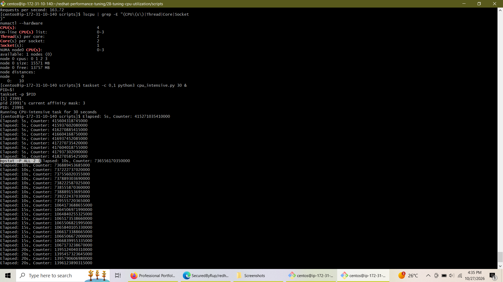
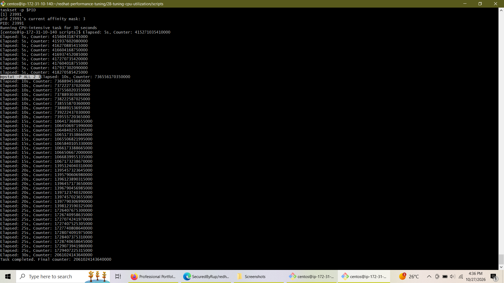
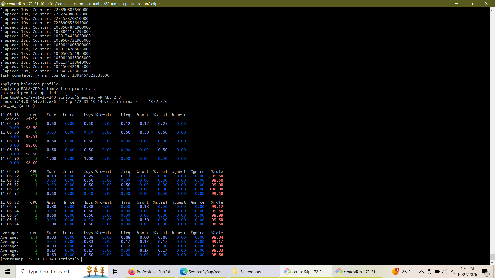
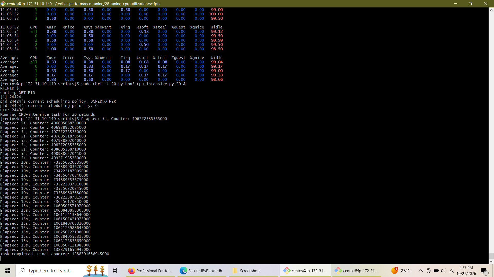
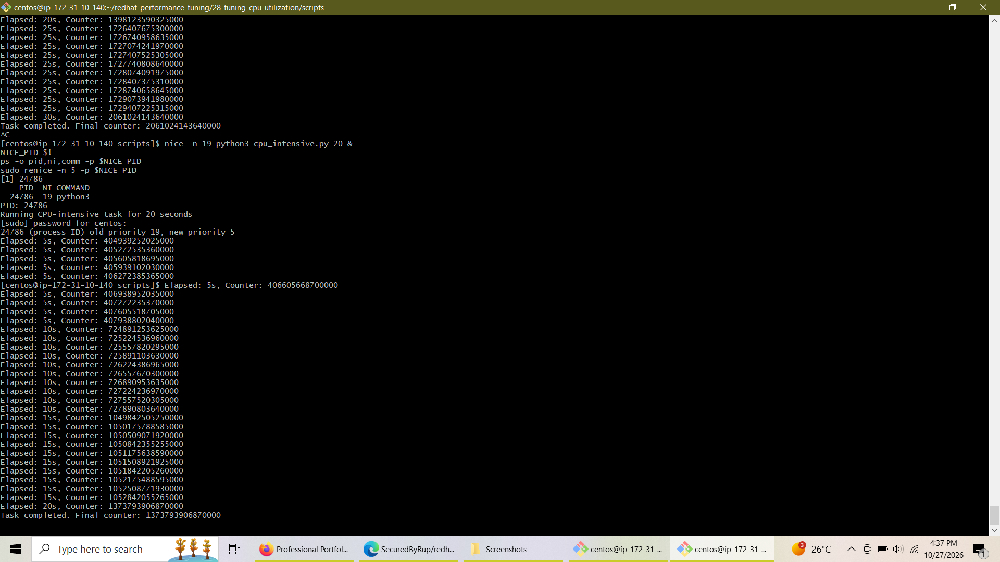
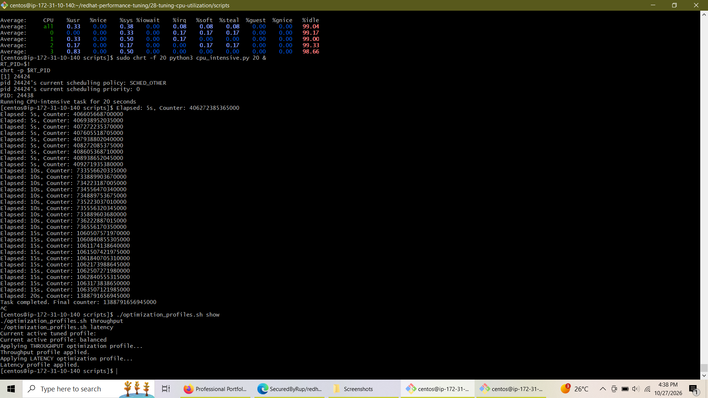

# Lab 8: Tuning CPU Utilization & Kernel Performance


---

## 📌 Executive Summary

This repository documents the execution, analysis, and modern kernel adaptation of **Lab 8: Tuning CPU Utilization** from the Red Hat Performance Tuning curriculum. Conducted inside an AWS cloud EC2 instance running Red Hat/CentOS 9, this lab demonstrates core optimization techniques including:

- **CPU Topology & NUMA Architecture Discovery**
- **Static & Dynamic CPU Affinity Binding (`taskset`)**
- **Real-Time Scheduling Policy Assignment (`chrt`)**
- **Standard Process Priority Management (`nice` & `renice`)**
- **Enterprise System Tuning via Profile Management (`tuned-adm`)**
- **Real-Time Per-Core Performance Monitoring (`sysstat` / `mpstat`)**

Additionally, this project addresses real-world migration challenges by refactoring legacy Completely Fair Scheduler (CFS) `sysctl` interface calls (deprecated in kernel v5.13+) into native RHEL 9 `tuned` profile optimizations.

---

## ⚙️ Target Environment & Architecture

- **Operating System:** CentOS Stream / RHEL 9 (Linux kernel `5.14.0-654.el9.x86_64`)
- **Hosting Platform:** Amazon Web Services (AWS EC2)
- **Private IP:** `172.31.10.140`
- **CPU Allocation:** 4 Logical Cores across 1 Socket (2 Cores/Socket, 2 Threads/Core)
- **NUMA Topology:** 1 NUMA Node (`node0`: 15,571 MB Total RAM, 13,757 MB Free)
- **Working Directory:** `/home/centos/redhat-performance-tuning/28-tuning-cpu-utilization/scripts`

---

## 🛠️ Step-by-Step Lab Execution & Evidence

### Phase 1: CPU Topology & Static CPU Affinity Binding

To eliminate unnecessary cross-core context switching and optimize cache locality, static CPU affinity masks were configured using `taskset`. 

Hardware topology was first evaluated using `lscpu` and `numactl --hardware`, confirming a 4-core single-NUMA node structure. A CPU-bound task was then bound strictly to CPU cores 0 and 1 using `taskset -c 0,1`.

```bash
# Topology check
lscpu | grep -E "(CPU\(s\)|Thread|Core|Socket)"
numactl --hardware

# Bind CPU-intensive workload to Cores 0,1
taskset -c 0,1 python3 cpu_intensive.py 30 &
PID=$!
taskset -p $PID
```


*Figure 1: Verification of CPU core layout and `taskset` affinity bitmask initialization (Bitmask 3 = Cores 0,1).*

---

### Phase 2: Execution Logging & Workload Isolation

Custom Python test scripts (`cpu_intensive.py` and `memory_intensive.py`) were created to generate deterministic CPU and memory bus contention. Running workloads under core affinity constraints demonstrated isolated thread execution while preventing core starvation on remaining system processors.


*Figure 2: Execution progression log for bounded python workload execution.*

---

### Phase 3: Per-Core Performance Monitoring (`mpstat`)

Using `mpstat -P ALL 2 3` from the `sysstat` toolkit, per-core CPU usage (`%usr`, `%sys`, `%idle`) was monitored to verify that load distribution remained bounded to designated CPU sets.

```bash
mpstat -P ALL 2 3
```


*Figure 3: Real-time per-core metric breakdown confirming isolated core load and idle state distributions.*

---

### Phase 4: Real-Time Scheduling Policies (`chrt`)

For latency-critical operations, standard Linux Completely Fair Scheduling (`SCHED_OTHER`) was elevated to a Real-Time First-In, First-Out policy (`SCHED_FIFO`) with priority level 20 using `chrt`.

```bash
# Assign Real-Time FIFO policy with priority 20
sudo chrt -f 20 python3 cpu_intensive.py 20 &
RT_PID=$!
chrt -p $RT_PID
```


*Figure 4: Transitioning process scheduling policy from `SCHED_OTHER` to `SCHED_FIFO` with priority 20.*

---

### Phase 5: Standard Process Priority & Dynamic Adjustment (`nice` / `renice`)

Non-real-time processes were managed using standard nice values. A background task was launched with lowest priority (`nice -n 19`) and dynamically reprioritized on the fly to `renice -n 5`.

```bash
# Launch with lowest priority
nice -n 19 python3 cpu_intensive.py 20 &
NICE_PID=$!
ps -o pid,ni,comm -p $NICE_PID

# Dynamically adjust priority
sudo renice -n 5 -p $NICE_PID
```


*Figure 5: Querying process nice level (`NI 19`) and dynamically elevating priority to `5` via `renice`.*

---

### Phase 6: Modern Enterprise Performance Tuning (`tuned-adm`)

In Linux kernel v5.13+, legacy CFS sysctl parameters (such as `kernel.sched_min_granularity_ns` and `kernel.sched_latency_ns`) were deprecated. To maintain compatibility with RHEL 9, the lab script `optimization_profiles.sh` was refactored into a wrapper around the enterprise `tuned-adm` framework.

```bash
# Query active system profile
./optimization_profiles.sh show

# Switch to high throughput profile
./optimization_profiles.sh throughput

# Switch to low latency profile
./optimization_profiles.sh latency
```


*Figure 6: Seamless profile transitions between `throughput-performance` and `latency-performance` via tuned.*

---

## 📸 Image Artifact Mapping Table

For repository maintainers, the screenshot filenames embedded in this documentation correlate to the original terminal capture files as follows:

| Target Markdown File Path | Original Uploaded Screenshot | Description |
| :--- | :--- | :--- |
| `./images/01-cpu-topology-and-affinity-binding.png` | `Screenshot (702).png` | Hardware topology discovery & core binding confirmation |
| `./images/02-mpstat-per-core-utilization.png` | `Screenshot (703).png` | `mpstat` per-core metrics under affinity constraints |
| `./images/03-taskset-execution-log.png` | `Screenshot (704).png` | Execution trace of bounded Python workload |
| `./images/04-chrt-realtime-fifo-scheduling.png` | `Screenshot (705).png` | Real-time `SCHED_FIFO` policy configuration |
| `./images/05-nice-renice-priority-adjustment.png` | `Screenshot (706).png` | `nice` initialization and `renice` dynamic modification |
| `./images/06-tuned-adm-profile-switches.png` | `Screenshot (707).png` | Refactored `tuned-adm` profile application logs |

---

## 💡 Conclusion

Through the execution of this lab, key CPU optimization strategies were successfully validated:

1. **Deterministic Core Allocation:** Hard CPU affinity prevents cache thrashing and guarantees predictable performance for dedicated workloads.
2. **Prioritization Flexibility:** Real-time scheduling (`chrt`) and nice adjustments (`renice`) effectively isolate background maintenance from mission-critical tasks.
3. **Modern RHEL Architecture Alignment:** Pivoting from legacy `sysctl` CFS flags to standard `tuned-adm` profiles ensures long-term operational consistency across modern RHEL 9 cloud deployments.